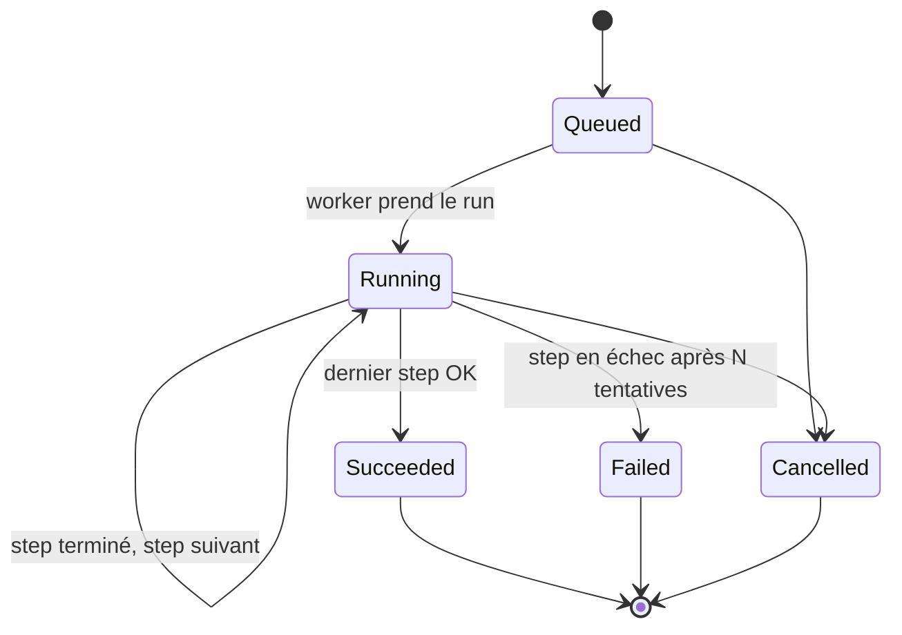
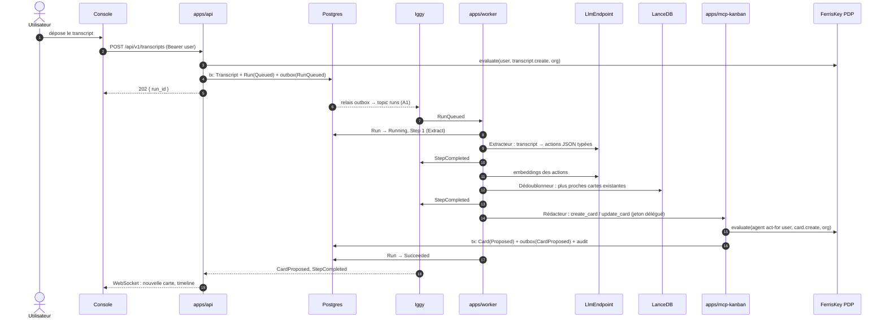

# Architecture Capitainerie

Statut : **proposition**. D1 et D5 tranchés. Les manques côté FerrisKey sont dans `docs/ferriskey-needs.md`. Les choix marqués `D<n>` dépendent de `docs/CONVENTIONS.md` § À trancher. Les choix marqués `A<n>` sont listés en fin de document, avec deux options chacun.

## 1. Workspace

Aligné sur mestier (un crate `core` hexagonal). Les adapters lourds sont isolés dans des crates dédiés (D2). Les noms de package sont préfixés `capitainerie-` (D6).

```
apps/
  api/              binaire axum : API REST de la console + OpenAPI + WebSocket temps réel
  worker/           binaire : consomme les événements de run dans Iggy, pilote les agents
  mcp-kanban/       binaire rmcp : serveur MCP Kanban, seul outil des agents
  console/          React 19 + TanStack (même stack que mestier/webapp)
libs/
  args/             config clap partagée
  common/           ids newtypes, CoreError, config
  events/           enveloppe RunEvent / CardEvent, catalogue ; ne dépend pas de core
  macros/           #[transactional], #[repository]
  telemetry/        init OTel (traces, métriques, logs), attributs GenAI
  auth/             vérif JWT FerrisKey multi-realm (JWKS par issuer), client token exchange RFC 8693
  authz/            adapter Authorizer → PDP AuthZEN de FerrisKey
  core/
    domain/         transcript, run, step, agent, card : entités, ports, services purs
    application/    CapitainerieUseCase : méthodes #[transactional], comme MestierUseCase (D1)
    infrastructure/ postgres (repositories, outbox)
  handlers/         AppState, ApiError, Response
  handlers-identity/ GET /api/v1/me
  handlers-runs/    transcripts + runs + timeline
  handlers-cards/   kanban
  handlers-agents/  agents actifs, coûts
  bus-iggy/         adapter EventBus
  runtime-rig/      adapter AgentRuntime ; seul crate qui dépend de rig / rig-rmcp
  llm/              adapter LlmEndpoint (OpenAI-compatible, reqwest)
  vector-lancedb/   adapter VectorStore
  analytics/        export Parquet + requêtes DataFusion
migrations/
deploy/             docker-compose de dev, config FerrisKey seed
```

Dépendances : `apps → handlers-* → core ← {bus-iggy, runtime-rig, llm, vector-lancedb, analytics, authz}`. Les ports vivent dans `core/domain`, les adapters les implémentent. Seuls les binaires connaissent les types concrets : alias de type, comme `MestierAuthorizer` dans mestier.

Le squelette (étape 4) crée les crates `common`, `events`, `macros`, `telemetry`, `args`, `core`, `handlers` et les trois apps. Les crates d'adapters arrivent avec le jalon qui en a besoin, ce qui évite d'ajouter une dépendance sans usage.

## 2. Domaine

| Entité | Champs clés | Notes |
|---|---|---|
| `Transcript` | `id`, `org_id`, `submitted_by`, `title`, `body`, `created_at` | Texte brut, immuable. |
| `Run` | `id`, `org_id`, `transcript_id`, `initiated_by`, `status`, `pipeline`, `created_at`, `finished_at` | Machine à états persistée. |
| `Step` | `id`, `run_id`, `agent_id`, `seq`, `attempt`, `status`, `input`, `output`, `tokens_in`, `tokens_out`, `cost_micros`, `latency_ms`, `trace_id` | Une exécution d'agent. Idempotente par `(run_id, seq, attempt)`. |
| `Agent` | `id`, `org_id`, `kind`, `client_id` (FerrisKey), `model`, `prompt_version` | Un client FerrisKey par agent. |
| `Card` | `id`, `org_id`, `title`, `description`, `column`, `version`, `provenance`, `created_by_run` | `provenance = { transcript_id, start, end, quote }` : le passage exact. |

### Machine à états du `Run`



Pipeline MVP : `Extract → Deduplicate → Write`. Chaque transition est une méthode du domaine (`Run::start`, `Run::complete_step`, ...) qui refuse les transitions invalides et produit un événement.

Colonnes Kanban : `Proposed → Todo → InProgress → Done`, plus `Rejected`. Seul un humain fait sortir une carte de `Proposed`. Cette règle est vérifiée par le PDP, pas seulement par l'UI.

## 3. Ports et adapters

| Port (`core/domain`) | Adapter MVP | Crate |
|---|---|---|
| `AgentRuntime` | Rig + rig-rmcp. Aucun type Rig dans la signature du port. | `runtime-rig` |
| `LlmEndpoint` | HTTP OpenAI-compatible (vLLM en prod, Ollama en dev) | `llm` |
| `EventBus` | Iggy | `bus-iggy` |
| `VectorStore` | LanceDB | `vector-lancedb` |
| `RunRepository`, `StepRepository`, `TranscriptRepository`, `CardRepository` | Postgres, sqlx `query!` | `core/infrastructure/postgres` |
| `Authorizer` | PDP AuthZEN FerrisKey (`POST /realms/{realm}/authzen/access/v1/evaluation`, voir A9) | `authz` |
| `Analytics` | DataFusion sur des fichiers Parquet | `analytics` |

## 4. Flux : transcript → run → cartes



Outbox (A1, en place) : `with_tx_emitting` écrit les événements émis dans `outbox_events` **dans la transaction métier**, puis `pg_notify('outbox_events')`, livré au commit seulement. Le relais (`OutboxRelay`, dans `apps/worker`) se réveille sur la notification, ou toutes les 2 s en secours. Il verrouille un lot (`FOR UPDATE SKIP LOCKED`), le publie dans Iggy puis marque `published_at`. Si le process meurt entre la publication et le marquage, le lot est republié : la livraison est *at least once*, et les consommateurs dédupliquent sur `EventEnvelope.id` (aussi utilisé comme id de message Iggy). Topologie Iggy : stream `capitainerie`, un topic par `Topic` (`runs`), 3 partitions, clé de partition = `run_id`, ce qui garde l'ordre des événements d'un même run.

Autorisation (en place) : le port `Authorizer` est de forme AuthZEN (sujet, action, ressource, acteur). L'adapter actuel est `LocalPolicyEngine` (A9, option 2) : il refuse tout accès entre organisations et réserve `transcript.create` et `run.read` aux humains. Il est vérifié avant chaque écriture et chaque lecture dans les services de domaine.

Durabilité : Postgres est la source de vérité de l'état du `Run`. Iggy transporte chaque transition. Au redémarrage, le worker relit les runs `Running` et reprend au premier step non terminé. Rejouer un run revient à relire son topic depuis l'offset 0 ; les steps sont idempotents par `(run_id, seq, attempt)`.

Agents d'itération : ils consomment `CardEvent` (`CardApproved`, `CardRefineRequested`) et créent un `Run` dont le pipeline ne contient qu'un step. Le mécanisme est le même.

## 5. Flux d'identité

```mermaid
sequenceDiagram
  autonumber
  actor U as Utilisateur
  participant C as Console
  participant FK as FerrisKey (realm de l'org)
  participant API as apps/api
  participant W as worker (agent = client FK)
  participant MCP as mcp-kanban
  participant PDP as PDP AuthZEN

  U->>C: login
  C->>FK: Authorization Code + PKCE
  FK-->>C: access token (aud = capitainerie-api)
  C->>API: requêtes Bearer
  API->>FK: JWKS de l'issuer (cache par realm)
  Note over API: realm = org ; issuer autorisé si présent dans la table organizations
  API->>FK: crée un grant de délégation (user, agent X, aud capitainerie-mcp, run_id) (A2)
  FK-->>API: handle du grant
  W->>FK: client_credentials (agent X) → actor_token
  W->>FK: token exchange : subject = grant, actor = actor_token (à chaque expiration)
  FK-->>W: jeton { sub: user, act: { sub: agent X } }, aud = capitainerie-mcp
  W->>MCP: tools/call create_card (Bearer délégué)
  MCP->>MCP: vérifie la signature, l'aud, la présence d'act
  MCP->>PDP: evaluate(subject = user, action = card.create, resource = card, context.actor = agent X)
  PDP-->>MCP: allow / deny
  MCP->>MCP: audit (user, agent, décision, trace_id)
```

- Un realm FerrisKey par organisation. L'API accepte plusieurs issuers, connus via la table `organizations`.
- Vérification d'un token (`libs/auth`, middleware `libs/handlers/src/auth.rs`), dans cet ordre :
  1. lecture de `iss` sans vérification ;
  2. l'issuer doit appartenir à une organisation, sinon 401 (aucune clé n'est jamais récupérée chez un issuer inconnu) ;
  3. JWKS obtenu via la découverte OIDC, en cache par issuer, re-fetch au plus une fois par 30 s sur `kid` inconnu ;
  4. signature RS256, `iss`, `exp` (30 s de tolérance), `typ = Bearer` ;
  5. `azp` dans `AUTH_ACCEPTED_CLIENTS`, car FerrisKey n'émet pas d'audience API (`docs/ferriskey-needs.md`, besoin 3). Pour un token délégué, c'est le `client_id` de l'acteur courant (`act`) qui est vérifié.
- La console utilise le flux Authorization Code + PKCE, avec `redirect_uri = /callback`. Cette route est hors du layout authentifié : elle traite le `code`, puis renvoie vers la page demandée au départ (`returnTo`, chemin local uniquement).
- Chaque agent est un client FerrisKey confidentiel du realm de l'org. Une `token_exchange_policy` FerrisKey (`allow_delegation = true`, `target_audience = capitainerie-mcp`) autorise l'échange. Le support existe dans FerrisKey : `core/src/domain/authentication/token_exchange/services.rs`.
- Le MCP Kanban est une ressource protégée : métadonnées RFC 9728, challenge `WWW-Authenticate`, comme `mestier/apps/mcp-gateway`.

## 6. Observabilité

- `telemetry` exporte les **spans** en OTLP/gRPC quand `OTLP_ENDPOINT` est défini ; les logs restent sur stderr. Jaeger (A6) n'accepte que des traces. Métriques et logs OTLP arriveront avec un collecteur, si le besoin apparaît : les coûts viennent de DataFusion, pas de métriques OTel.
- Spans selon les conventions GenAI : `gen_ai.operation.name`, `gen_ai.request.model`, `gen_ai.usage.input_tokens`, `gen_ai.usage.output_tokens`, `gen_ai.tool.name`. Le `trace_id` voyage dans l'enveloppe Iggy, si bien qu'un run forme une seule trace de l'API au MCP.
- La console lit :
  - **runs en cours, timeline, agents actifs** depuis Postgres (`runs`, `steps`, `pdp_decisions`), en direct via WebSocket ;
  - **coûts par run, agent et utilisateur** depuis `analytics` (DataFusion sur Parquet). Le coût = tokens × prix par modèle, défini en config.
- Dev local : collecteur OTel + un backend de traces (A6).

## 7. Dev local (étape 4)

`docker-compose.yml` : `postgres:17`, `apache/iggy:0.9.0`, `ferriskey-api` (+ job de migrations), `ferriskey-webapp`, `jaeger`. Ports dans la plage 4000–4199 pour ne pas entrer en conflit avec mestier et FerrisKey en local (voir `README.md`).

Pour le jalon 1 : `ollama`, et un script de seed FerrisKey qui crée le realm de démo, les clients `capitainerie-console`, `capitainerie-api`, `capitainerie-mcp`, un client par agent et la `token_exchange_policy`.

Iggy 0.9 sous Docker Desktop : `IGGY_SHARDING_CPU_ALLOCATION=1`, sinon le serveur échoue à fixer la mémoire des shards sur un nœud NUMA.

## 8. Décisions ouvertes

Ces choix ne sont couverts par aucun des repos de référence. Chacun propose deux options et une recommandation.

| # | Décision | Option 1 | Option 2 | Reco |
|---|---|---|---|---|
| A1 | Postgres → Iggy | **Outbox** : événement écrit dans la transaction, un relais publie dans Iggy | Publication directe dans Iggy après le commit | 1 : reprend la règle mestier « un événement existe si et seulement si sa transaction a commité ». Aucun événement n'est perdu si le process meurt entre le commit et la publication. |
| A2 | Jeton délégué pour un run asynchrone (le jeton user expire en 5 min) | **Grant de délégation FerrisKey** : consentement créé au dépôt, échangé par l'agent autant de fois que nécessaire | Stocker un refresh token `offline_access` chiffré par run | 1, mais **manquant dans FerrisKey** : un jeton échangé ne vit jamais plus longtemps que son jeton d'origine (`exchanged_claims`). Voir `docs/ferriskey-needs.md` Besoin 2. En attendant (dev seulement) : durée de vie des access tokens du realm de démo relevée à 30 min, et échange au dépôt. |
| A3 | Hébergement du MCP Kanban | **Binaire séparé** `apps/mcp-kanban` | Routes montées dans `apps/api` | 1 : audience distincte et surface réduite, comme `mestier/apps/mcp-server`. |
| A4 | Embeddings pour LanceDB | **Même endpoint OpenAI-compatible** (`/v1/embeddings`) | Modèle local in-process (`fastembed`) | 1 : aucune nouvelle dépendance, un seul endpoint à opérer. |
| A5 | Stockage Parquet | **S3-compatible** (RustFS en dev, comme les deux repos) | Volume local | 1 : déjà présent dans la stack Ferrislabs, et adapté à Kubernetes. |
| A6 | Backend de traces en dev | **SigNoz** (comme mestier) | Jaeger seul | 2 pour le MVP : un seul conteneur, et la console Capitainerie affiche elle-même coûts et timeline. |
| A7 | Provisioning des clients agents | **Seed déclaratif** (script au démarrage du compose) | Provisioning par l'API admin FerrisKey à la création de l'org | 1 pour le MVP, 2 plus tard. |
| A8 | LLM en dev | **Ollama** (API OpenAI-compatible) | vLLM en CPU | 1 : plus simple sur un poste de dev. |
| A9 | PDP AuthZEN FerrisKey : le endpoint HTTP est seulement spécifié (`docs/design/authz/07-http-authzen.md`), et ni `main` ni `origin/main` ne l'exposent. | Attendre le endpoint FerrisKey | Adapter `Authorizer` local temporaire (comme `LocalPolicyEngine` de mestier) derrière le même port, puis bascule | 2. Besoin transmis dans `docs/ferriskey-needs.md` Besoin 1. |
